# BÁO CÁO BÀI TẬP THỰC HÀNH LẬP TRÌNH C# WINFORMS

## I. THÔNG TIN SINH VIÊN

* **Họ và tên:** Trần Nhật Đông
* **Mã số sinh viên:** 24810320177
* **Lớp học phần:** Lập trình .NET - Mã Lớp: ........
* **Link Repository:** https://github.com/nhatdong711/Tr-n-Nh-t-ng-24810320177

---

## II. DANH SÁCH BÀI TẬP HOÀN THÀNH & TỰ ĐÁNH GIÁ

| Bài tập | Tiêu đề bài tập | Trạng thái | Mức độ hoàn thành (%) |
| :---: | :--- | :---: | :---: |
| **Bài 1** | Quản lý Dịch vụ Phòng Gym & Hội viên | Hoàn thành | 100% |
| **Bài 2** | Quản lý Tài liệu Sách & Xuất Báo cáo Nhà sách | Hoàn thành | 100% |
| **Bài 3** | Hệ thống MDI Quản lý Bệnh viện | Hoàn thành | 100% |
| **Bài 4** | Bảng Điều khiển Thống kê Doanh thu (Async/Await) | Hoàn thành | 100% |
| **Bài 5** | Mô phỏng Giám sát Tỷ giá Thời gian thực (Thread Safety) | Hoàn thành | 100% |

---

## III. MINH HỌA GIAO DIỆN & KỸ THUẬT NỔI BẬT

### 1. Bài 1: Quản lý Dịch vụ Phòng Gym & Hội viên
* **Kỹ thuật áp dụng:**
  - DataGridView cấu hình hoàn toàn bằng code (`AutoGenerateColumns = false`), `DataPropertyName` khớp với class `MemberModel`; cột phí định dạng `N0`.
  - Data Binding 2 chiều: `BindingList<MemberModel>` + `BindingSource`; `MemberModel` cài đặt `INotifyPropertyChanged` nên khi bấm Sửa, lưới cập nhật ngay không cần nạp lại.
  - Kiểm tra dữ liệu bằng `ErrorProvider` + Regex: tên không trống/không ký tự đặc biệt, SĐT đúng 10 chữ số, phí là số nguyên dương.
  - Tự sinh mã HV001, HV002…; xóa có hộp thoại Yes/No kiểu `MessageBoxIcon.Warning`.
* **Hình ảnh minh họa Giao diện:**

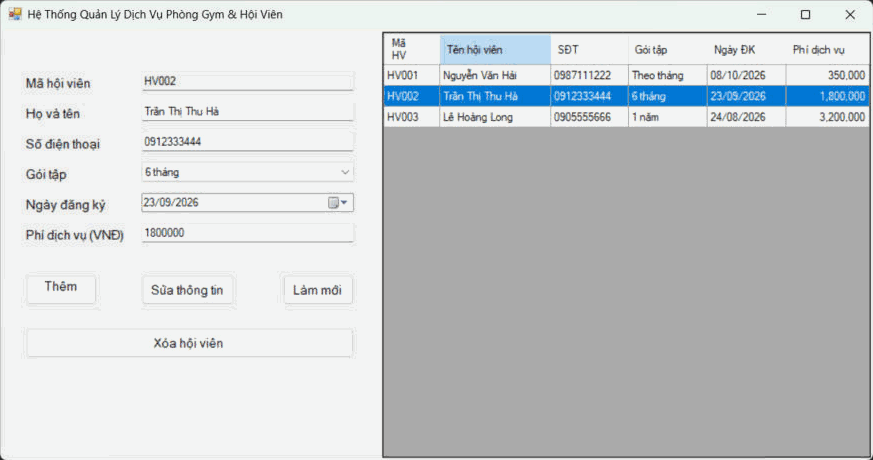
*Mô tả: Chọn một dòng trên lưới, thông tin hội viên lập tức được đồng bộ lên các ô nhập.*

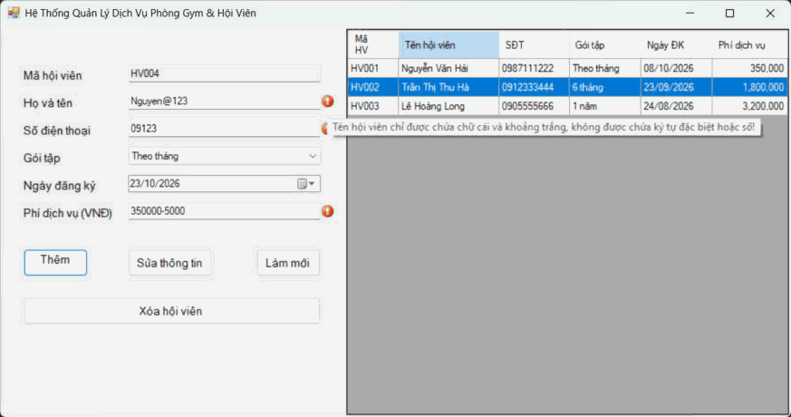
*Mô tả: Nhập tên có ký tự đặc biệt, SĐT sai, phí không hợp lệ rồi bấm Thêm, ErrorProvider báo lỗi cạnh từng ô.*

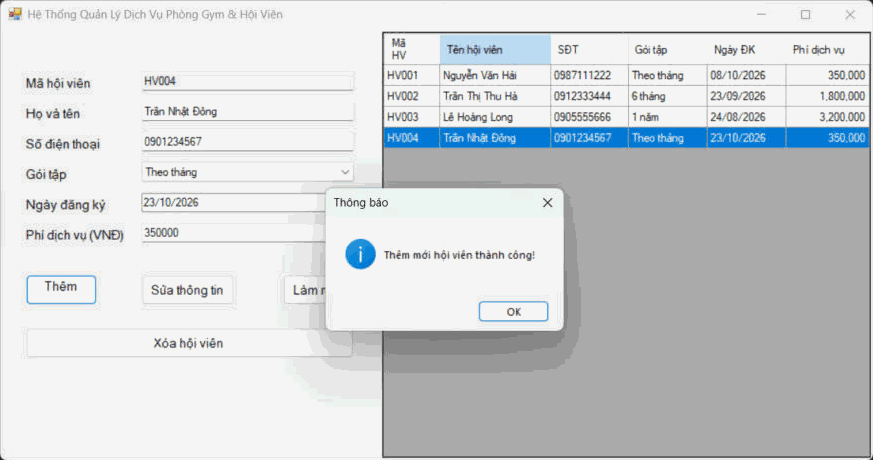
*Mô tả: Dữ liệu hợp lệ, hội viên HV004 được thêm vào danh sách.*

---

### 2. Bài 2: Quản lý Tài liệu Sách & Xuất Báo cáo Nhà sách
* **Kỹ thuật áp dụng:**
  - `MenuStrip` (File: Mở/Lưu file CSV, Thoát; Edit: Thêm, Xóa, Tìm kiếm), `ToolStrip` có icon (Mở file, Lưu file, Thêm mới).
  - `OpenFileDialog` chọn ảnh bìa (*.png, *.jpg), hiển thị lên `PictureBox`, lưu đường dẫn vào `BookModel`; lưới chỉ hiện tên file ảnh.
  - `SaveFileDialog` xuất danh sách ra file `.csv` (có xử lý dấu phẩy/ngoặc kép); `OpenFileDialog` đọc từng dòng CSV, parse thành `BookModel` và nạp vào `BindingList<T>`.
  - `StatusStrip` tự cập nhật Tổng số đầu sách, Tổng giá trị kho (qua sự kiện `ListChanged`) và đồng hồ thời gian hiện tại.
* **Hình ảnh minh họa Giao diện:**

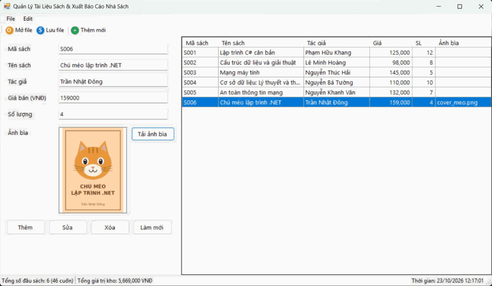
*Mô tả: Nạp 6 đầu sách từ file CSV, chọn ảnh bìa từ ổ cứng hiển thị lên PictureBox; StatusStrip cập nhật tổng số sách và tổng giá trị kho.*

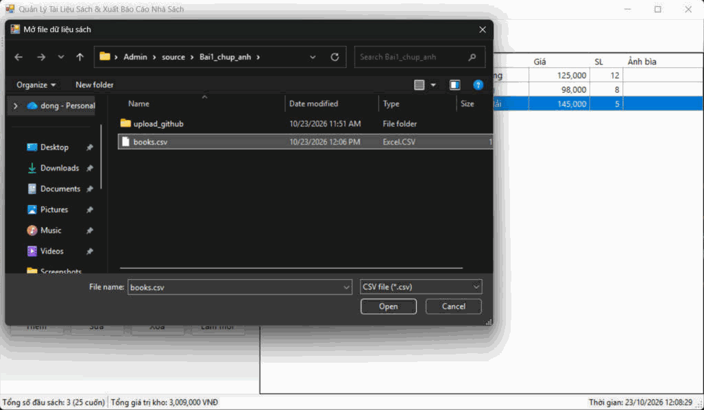
*Mô tả: Hộp thoại OpenFileDialog lọc file `.csv` để nhập dữ liệu sách.*

---

### 3. Bài 3: Hệ thống MDI Quản lý Bệnh viện
* **Kỹ thuật áp dụng:**
  - Form cha `frmHospitalMain` với `IsMdiContainer = true`; MenuStrip Hệ thống / Quản lý / Cửa sổ.
  - Chống mở trùng Form con: duyệt `MdiChildren`, nếu đã mở thì `Activate()`, chưa có thì tạo mới, gán `MdiParent = this` và `.Show()`.
  - Sắp xếp cửa sổ bằng `LayoutMdi(MdiLayout.Cascade / TileHorizontal / TileVertical)`, Đóng tất cả.
  - `StatusStrip` hiển thị bác sĩ trực và `ToolStripProgressBar`; chức năng "Nạp lại dữ liệu" chạy `async/await` + `Task.Run`, báo tiến độ qua `IProgress<int>`.
* **Hình ảnh minh họa Giao diện:**

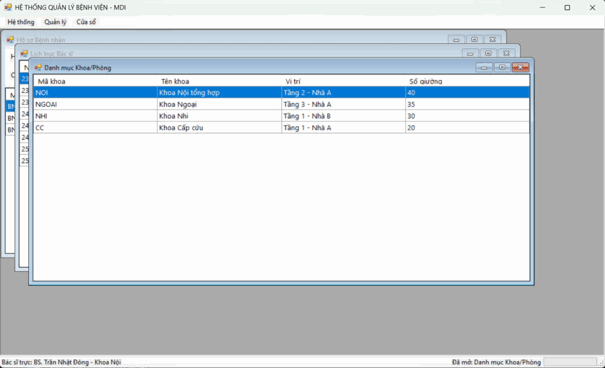
*Mô tả: Form cha MDI mở 3 form con (Hồ sơ Bệnh nhân, Lịch trực Bác sĩ, Danh mục Khoa/Phòng) xếp tầng.*

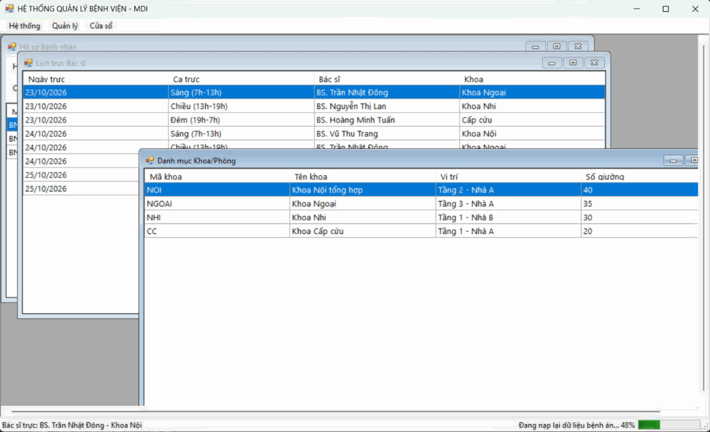
*Mô tả: Đang nạp lại dữ liệu (48%), vẫn kéo rê form con bình thường, giao diện không bị treo.*

---

### 4. Bài 4: Bảng Điều khiển Thống kê Doanh thu Multi-Threading
* **Kỹ thuật áp dụng:**
  - `await Task.Run(...)` đẩy việc giả lập truy xuất & tổng hợp dữ liệu (~5 giây) xuống Background Thread; UI vẫn di chuyển, phóng to/thu nhỏ, nhập liệu bình thường.
  - Báo tiến độ an toàn qua `IProgress<ProgressInfo>` cập nhật `ProgressBar` và `lblProcessingStatus`.
  - Hủy tác vụ bằng `CancellationTokenSource`, bắt `OperationCanceledException`, dừng ProgressBar và thông báo "Đã hủy thao tác!".
* **Hình ảnh minh họa Giao diện:**

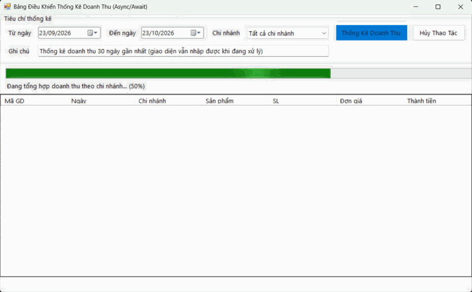
*Mô tả: Đang xử lý 50%, người dùng vẫn gõ được vào ô Ghi chú.*

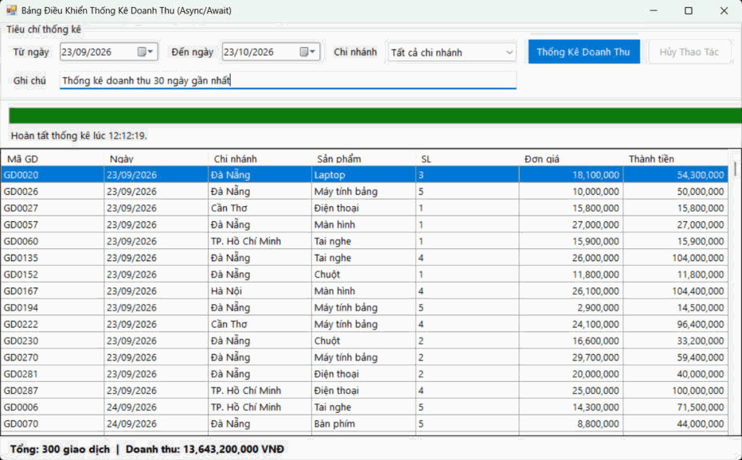
*Mô tả: Kết quả thống kê 300 giao dịch và tổng doanh thu.*

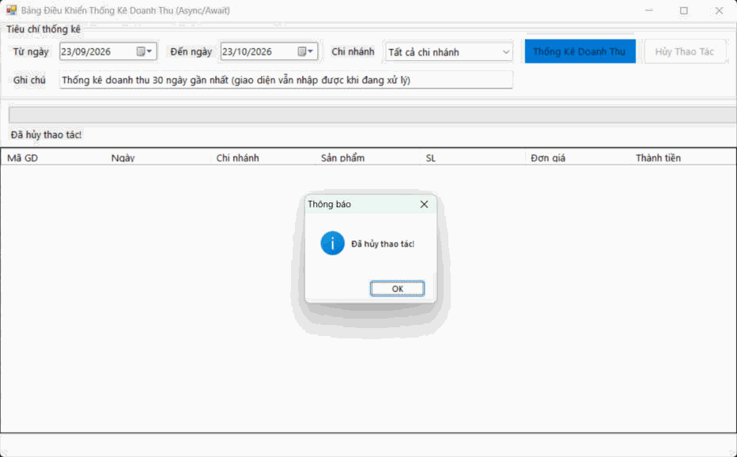
*Mô tả: Bấm [Hủy Thao Tác] giữa chừng, tiến trình ngầm dừng an toàn.*

---

### 5. Bài 5: Mô phỏng Giám sát Tỷ giá Tài chính Thời gian thực
* **Kỹ thuật áp dụng:**
  - [Bắt đầu Giám sát] khởi chạy `Task.Run` với vòng lặp vô hạn, cứ 2 giây sinh tỷ giá BTC/USD mới; [Tạm dừng] dùng `CancellationTokenSource` để dừng.
  - Thread Safety: dữ liệu từ Background Thread không cập nhật trực tiếp lên Control mà kiểm tra `this.InvokeRequired` rồi gọi `this.Invoke(new Action<decimal>(...))` để chạy trên UI Thread, không phát sinh `InvalidOperationException: Cross-thread operation not valid`.
  - Label giá đổi màu xanh khi tăng, đỏ khi giảm; StatusStrip hiển thị lần cập nhật cuối (HH:mm:ss) và số lượt đồng bộ; `dgvHistoryLog` ghi nhật ký mỗi lần quét.
* **Hình ảnh minh họa Giao diện:**

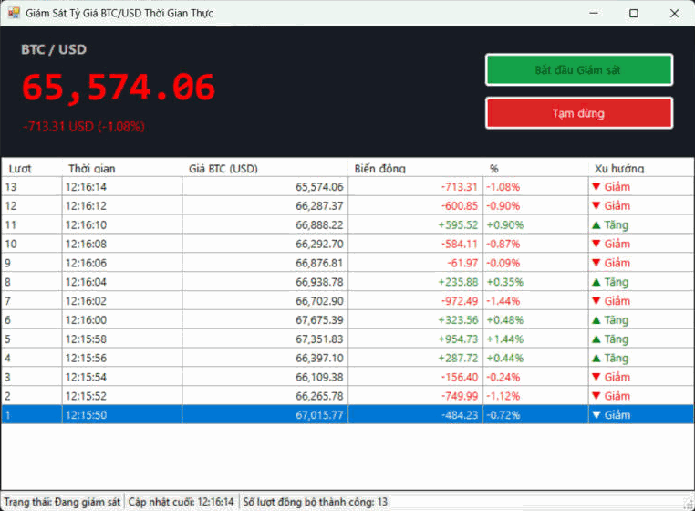
*Mô tả: Bảng tỷ giá tự đổi màu theo xu hướng và nhật ký lịch sử biến động qua 13 lần quét.*

---

## IV. HƯỚNG DẪN CÀI ĐẶT & CHẠY DỰ ÁN

1. **Clone Repository về máy:**
   ```bash
   git clone https://github.com/nhatdong711/Tr-n-Nh-t-ng-24810320177.git
   ```
2. **Mở Solution:** mở file `src/WinFormsAppSolution.sln` bằng Visual Studio 2022 (.NET Framework 4.7.2).
3. **Chọn Project khởi động:** chuột phải vào `Bai1` … `Bai5` trong Solution Explorer → **Set as Startup Project**.
4. **Chạy:** nhấn **F5** hoặc **Start**. Dữ liệu mẫu cho Bài 2 (file CSV và ảnh bìa) nằm trong `src/Bai2/SampleData/`.
